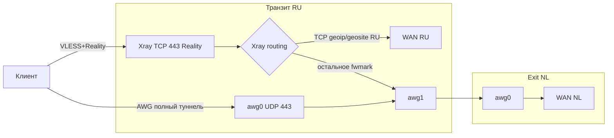

# AWG + Xray/VLESS+Reality на одной паре

План, не внедрение. AWG 3.1 остаётся основным входом. Xray — запас на случай, если UDP/AWG перестанут подниматься, плюс geo-сплит только для TCP на RU.

Смежные документы: [deploy_transit.md](deploy_transit.md), [deploy_exit.md](deploy_exit.md), [deploy_middle.md](deploy_middle.md), [deploy_ansible.md](deploy_ansible.md), [awg2_protocol_params.md](awg2_protocol_params.md), [awg3_protocol_params.md](awg3_protocol_params.md).

## Решение

- **Сейчас не внедряем.** Существенная часть схемы уже есть: AWG 3.1 на UDP/443, цепочка из двух hop (entry→exit) или трёх (entry→middle→exit).
- Имеет смысл, только если есть живой кейс: оператор режет UDP, но пускает TLS на тот же RU IP; или Сбер/госуслуги отваливаются с NL IP, а VPN выключать не хочется.
- Тогда шаг — VLESS+Reality по TCP/443 (как дефолт Amnezia/Hiddify), не Hysteria и не свой домен.

## Текущая база

Цепочка заточена под L3 (пара или тройка):

- **Транзит (entry, RU):** клиенты на `awg0` (UDP 443, `10.10.2.0/24`) → policy routing `clientroute` → `awg1` → exit (пара) или middle → exit (тройка).
- **Exit (NL):** `awg0` (`10.10.1.0/24`), MASQUERADE в интернет.
- nftables на транзите пускает только **UDP 443**, не TCP. MSS clamp висит на `forward`, не на локально сгенерированных пакетах.

Ключи: [ansible/templates/nftables-entry.conf.j2](../ansible/templates/nftables-entry.conf.j2), [ansible/tasks/entry/05_create_awg_config.yml](../ansible/tasks/entry/05_create_awg_config.yml), [ansible/tasks/forwarder/06_configure_awg1.yml](../ansible/tasks/forwarder/06_configure_awg1.yml).

## Целевая топология

Два протокола — **разные роли**, не два одинаковых VPN:

- **AWG (основной):** полный туннель в NL, нативный UDP. Путь для Telegram/WhatsApp **звонков**. Банки с NL IP могут капризничать — это уже так.
- **Xray (запас + RU TCP):** когда ТСПУ режет UDP/AWG. Чат мессенджеров по TCP обычно жив; звонки через Reality — UDP-over-TCP, хуже. Geo-сплит только чтобы Сбер/госуслуги ходили с IP транзита.

Exit **не** слушает Reality.

## Почему UDP 443 и TCP 443 не конфликтуют

Ядро биндит сокеты по (proto, ip, port). AWG занимает **UDP/443**, Xray — **TCP/443**. Это нормальная и желаемая пара: DPI часто режет один класс (UDP/QUIC-like или TLS), второй остаётся запасным входом.

Нужно только открыть TCP 443 в [nftables-entry.conf.j2](../ansible/templates/nftables-entry.conf.j2). На exit TCP 443 не открываем.

SSH остаётся на 22. HTTPS на этом IP больше не посадить — 443 TCP заберёт Reality. Для этой роли сервера это ок.

## ТСПУ и общий порт 443

Сам факт «оба на 443» для ТСПУ **не проблема и скорее плюс**. Живой HTTP/3 сайт как раз слушает TCP/443 (TLS) и UDP/443 (QUIC). Сейчас транзит — только UDP/443 с `quic_initial` ([awg2_protocol_params.md](awg2_protocol_params.md)): с точки зрения классификатора это «QUIC без HTTPS». TCP Reality на том же порту дорисовывает ожидаемую пару.

ТСПУ смотрит **потоки**, не bind. TCP и UDP 443 — разные классификаторы. Двойной вход: порезали фейковый QUIC — остаётся TLS; поймали Reality — остаётся AWG. Перенос AWG на случайный UDP-порт хуже: не-443 UDP режут охотнее.

Где ТСПУ реально кусается — не общий порт, а идентичность IP и нестыковка легенд:

- **Поток AWG (UDP):** детект фейкового QUIC / AWG 3.x. Это уже есть, Xray это не усиливает.
- **Поток Reality (TCP):** рукопожатие закрывает Reality+Vision. В 2026 чаще ловят **поведение после хендшейка** (длинный двусторонний туннель), а не «чужой SNI на VPS». ASN-сверка SNI↔IP описана, но массовые гайды всё равно живут на microsoft/github; свой редкий домен эту дыру не закрывает лучше.
- **Корреляция TCP+UDP (вторично):** TCP отвечает сертификатом dest, UDP не завершает настоящий HTTP/3 (это AWG). Dual-probe на каждый VPS делают не всегда.
- **Общая судьба IP:** бан адреса сжигает оба входа. Сейчас IP уже светится AWG; Reality добавляет вторую поверхность.

Практический вывод: оба на 443, AWG с UDP не двигаем. Отдельный IP под Reality — только если после добавления TCP начнут жечь адрес целиком.

## Dest для Reality: чужой сайт, без своего домена

Steal-oneself (свой домен + заглушка) **не берём на старте**. Это отдельный монстр (nginx/Caddy, ACME на :80, «реалистичный» сайт), и по картине 2026 он не то, что чинит ТСПУ.

Источники:

- [Хабр, 2026](https://habr.com/ru/articles/1009542/): Reality закрывает хендшейк и зонд. Ломают слой 4 — паттерн после TLS. Донор — крупный сервис с PoP везде (`github.com`, `www.twitch.tv`, `www.microsoft.com`). Плохо: `apple.com` (свой ASN) и мелкий сайт.
- XTLS: steal-oneself — опция для CN/IR (белый список SNI). Для личного узла не обязателен.
- [vpn.how](https://vpn.how/ru/pages/hto-takoe-vlessreality.html): свой редкий домен как SNI хуже — в живом трафике его нет.
- [XTLS #5807](https://github.com/XTLS/Xray-core/discussions/5807): dest на Cloudflare/Fastly опасен из‑за слепого fallback на shared CDN.

Если когда-нибудь поднимем: копировать **дефолт Amnezia/Hiddify**, не «максимум крутилок». VLESS + TCP/raw + Reality + `xtls-rprx-vision` + `fingerprint: chrome` + порт 443. Dest — крупный HTTPS с TLS 1.3/h2, не Cloudflare, проверить с транзита. Fragment и mux на Reality не включать. `spiderX` пустой (как Amnezia).

XHTTP — ответ на поведенческий слой, не замена Reality. На первую версию не тащим.

## Что реально ставят AmneziaVPN и Hiddify

По исходникам `amnezia-client`, HiddifyPanel, Hiddify-Manager, Hiddify-Reality-Scanner, hiddify-app. «Максимальная защита» у них — не steal-oneself и не десяток обфускаций, а один короткий стек.

Общий дефолт:

- VLESS, `encryption: none`, `decryption: none`
- транспорт **TCP/raw**, порт **443**
- `security: reality`, `show: false`
- `flow: xtls-rprx-vision` только на TCP+Reality (на XHTTP Amnezia flow снимает)
- uTLS **chrome** (Amnezia чистит ошибочный fingerprint `Mozilla/5.0`)
- `spiderX`: пустая строка у Amnezia

Где расходятся — dest/SNI:

- Amnezia: всегда `www.googletagmanager.com:443`. ShortId: `openssl rand -hex 8`.
- Hiddify: хост, который с **сервера** отвечает TLS 1.3 + ALPN `h2`. Empty `shortId` плюс случайный 2–16 hex. Reality Scanner гоняет SNI **с клиентской сети** к вашему IP.
- Fragment / mux в Hiddify-приложении выключены. В panel v3 fragment **не вешается на Reality**. Mux если включают — `xudpProxyUDP443: reject`.
- XHTTP у Amnezia есть, дефолт транспорта **raw**. Auto/packet-up при Reality → `stream-one` (единственный режим с Vision).
- Sniffing: Hiddify `http,tls,quic` без `routeOnly`. Amnezia на сервер sniffing не ставит.
- Hiddify за HAProxy: Reality-terminator на localhost + PROXY protocol (`xver: 2`) — это их панель, не голый транзит.

## Сводка: беседа vs AmneziaVPN vs Hiddify

| Тема | Мы в беседе | AmneziaVPN (дефолт) | Hiddify (дефолт) |
|------|-------------|---------------------|------------------|
| Роль рядом с AWG 3.1 | Запасной вход, не второй полноценный VPN. Звонки остаются на AWG | Отдельный контейнер Xray, AWG не трогает | Один из inbound в панели |
| Стоит ли ставить сразу | Нет, пока AWG жив на нужных операторах | Если пользователь выбрал Xray | Если включили Reality |
| Порт | TCP 443 рядом с AWG UDP 443 | 443 | 443 (сканер для пробы: 11443) |
| Dest / SNI | Крупный HTTPS, TLS 1.3, не CF/Apple; проверить с транзита | Всегда `www.googletagmanager.com:443` | Хост с TLS 1.3+h2 с сервера; сканер подбирает SNI с клиентской сети |
| shortId | Не решающий фактор | Один, 8 байт hex | Пустой `""` + случайный 2–16 hex |
| spiderX | — | Пустая строка | Не задают |
| fingerprint | `chrome` | `chrome` (чистит `Mozilla/5.0`) | `chrome` |
| flow | `xtls-rprx-vision` | Только TCP+Reality; на XHTTP снимают | Только Reality+TCP |
| XHTTP | Не в первой версии | Опция, дефолт `raw`; Auto+Reality → `stream-one` | Опция матрицы, не дефолт |
| Fragment / mux / padding | На Reality не включать | Нет | В приложении выкл.; panel v3 fragment на Reality не вешает |
| Sniffing | Для geo-сплита с Vision — `routeOnly: true` | На сервере нет | `http, tls, quic`, без `routeOnly` |
| Hysteria | Не брать: фильтр ТСПУ QUIC v1 + UDP/443 + ≥1001 байт | Не дефолт Xray | Умеет, к Reality не привязан |
| Geo-сплит / звонки | UDP и Telegram/WhatsApp всегда в NL; geo только TCP на RU | Нет из коробки | Нет из коробки |
| Steal-oneself | Не берём | Нет | Нет |

## ТСПУ и звонки

ТСПУ режет WhatsApp/Telegram-звонки как **STUN/UDP** (magic cookie `0x2112A442` и медиа). Сообщения часто живут (HTTPS). VPN помогает, только если STUN/RTP не вылезают на ISP.

1. **AWG — единственный нормальный путь для звонков.** Geo-сплит на AWG нельзя: вылезающий STUN ТСПУ снова убьёт.
2. **Наивный geoip на Xray ломает звонки.** Мессенджеры всегда `nl`; **весь UDP → `nl`**; geo только для TCP на RU. Клиент Xray только с TUN, не SOCKS без UDP. Даже тогда звонки на Reality хуже AWG (UDP-inside-TCP).
3. **Hysteria не берём.** Не «весь UDP мёртв» (иначе не жил бы AWG), а фильтр ТСПУ на настоящий QUIC: UDP/443 + version 1 (`0x00000001`) + payload ≥ 1001 байт ([ValdikSS / IMC 2022](https://doi.org/10.1145/3517745.3561461), [Хабр](https://habr.com/ru/articles/992232/)). RFC 9000 требует QUIC Initial ≥ 1200 байт — Hysteria на `:443` сама наступает на порог. AWG с `quic_initial` — мимикрия, не long-header QUIC v1. [Вики Amnezia](https://wiki.amnezia.host/en/amneziawg-tuning.html): если душат UDP как класс, нужен TCP/XRay.
4. **IPv6 / WebRTC.** В клиентах AWG `::/0`, на серверах v6 выключен — blackhole, не утечка, если стек заворачивает `::/0`. Иначе ICE с настоящим IPv6. На Xray `::` не слушать.
5. **`awg1` — общая точка отказа.** Reality спасает вход клиента, не межсерверный линк. Второй туннель транзит→exit сейчас не делаем.
6. **Kill switch на клиенте.** Секунда без AWG — STUN в ТСПУ.

## Geoip-сплит: как не сломать `clientroute`

Таблица `clientroute` ловит только клиентов AWG (`from 10.10.2.0/24`, `iif awg0`). Процесс Xray без доп. правила уйдёт в `main` → RU WAN.

Не uid-routing (утащит и RU в туннель), а **fwmark на outbound `nl`**:

- `direct` — `freedom`, без mark → `main` → RU WAN.
- `nl` — `freedom` + `sockopt.mark` (например `255`) + `ip rule fwmark 255 table clientroute`.
- `default dev awg1` в `clientroute` уже есть (PostUp awg1).
- MASQUERADE `10.10.2.0/24 oif awg1` для Xray не нужен: источник станет адресом awg1 (`10.10.1.2`), exit NAT'ит `10.10.1.0/24`.
- Надёжнее `sendThrough` = адрес awg1, иначе src может оказаться WAN IP и WireGuard на exit отбросит пакет.

Правила Xray (порядок важен):

- `geoip:private` → direct
- `geosite:telegram`, `geosite:whatsapp`, `geosite:facebook` → `nl`
- `network: udp` → `nl`
- TCP + (`geoip:ru` / `geosite:category-ru`) → direct
- всё остальное → `nl`

Sniffing обязателен. С Vision — только `routeOnly: true`.

## Нюансы

**MSS / MTU.** Clamp сейчас только в `forward`. Трафик Xray → awg1 идёт из `output` — нужен отдельный clamp, иначе обрывы HTTPS.

**Reality dest.** Dial делает сам Xray, на WAN, не через `nl`. Проверять TLS 1.3 с транзита.

**Клиенты.** `vless://` / JSON. Пиры — UUID + shortId, не ключи AWG. Дашборд в первую очередь не трогаем.

**Безопасность.** Пользователь `xray`, без WAN API, `show: false`.

## Что сознательно не делаем

- Reality на exit.
- Перенос AWG с UDP 443.
- Geo-сплит для AWG.
- Xray внутри AWG у клиента.
- Steal-oneself на старте.
- XHTTP / Hysteria2 в первой версии.
- Второй туннель транзит→exit (риск `awg1` осознаём).

## Порядок внедрения, когда дойдём до кода

Аддитивно на живую пару, без переинициализации AWG:

1. nftables: TCP 443 + MSS clamp на output/`awg1`.
2. `ip rule fwmark` (сохранить рядом с PostUp awg1).
3. xray-core + systemd + шаблон (Reality, UUID, routing, mark). Без Caddy/nginx и без своего домена.
4. Документация: dest, клиентский URI, AWG = звонки, Xray только TUN, проверка split и ICE.
5. Дашборд и выдача пиров Xray — позже.
